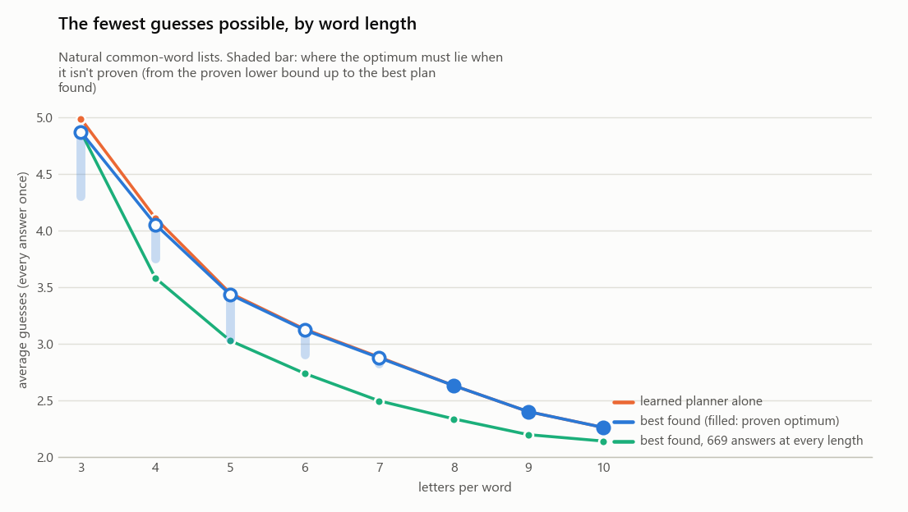
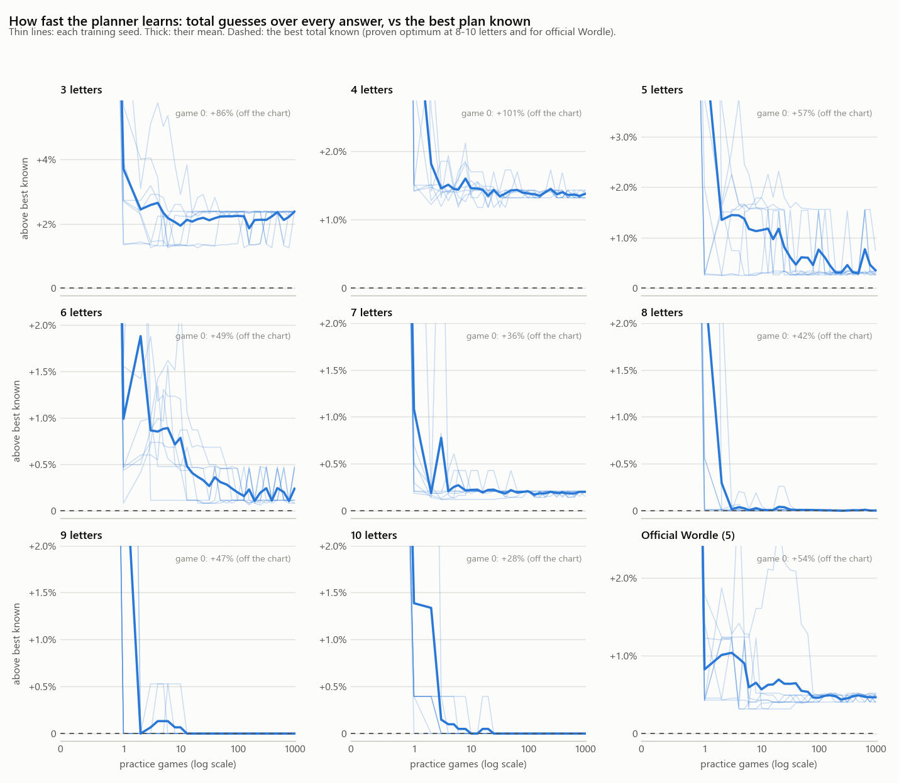
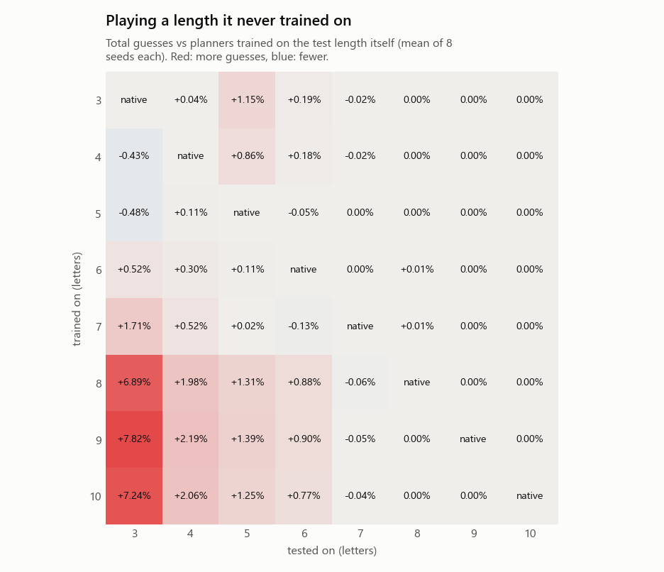
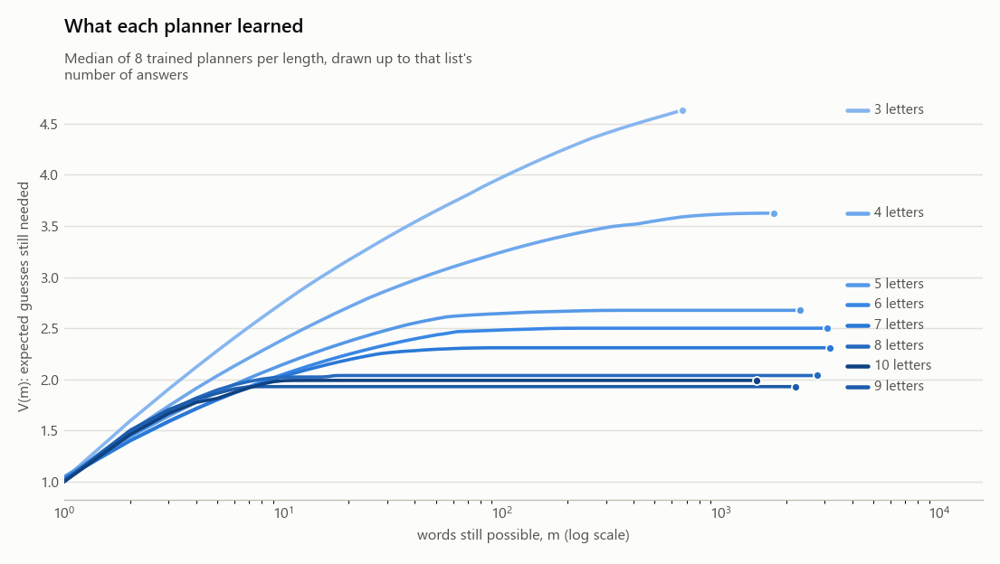

# Word length: the floor, how fast the AI gets there, and a length it never saw

Generated 2026-10-04 21:19 from the experiments in this folder (`python benchmark.py --limits-study`; rebuild this page with `python -m analysis.limits_report reports/2026-10-03_limits`).

## The answers

**1. The fewest guesses possible.** Longer words need far fewer guesses. Perfect play needs at most 4.87 guesses on average at 3 letters and exactly 2.26 at 10 (every answer of the common-word list once).
- Proven optimum (no strategy can do better, every valid guess considered): 8 letters: **2.6290** (7,277 guesses, opener CERATINS); 9: **2.3987** (5,294 guesses, opener CARTELISE); 10: **2.2596** (3,290 guesses, opener CENTRALISE).
- Not proven, but bracketed: 3 letters: between 4.303 (proven) and 4.8729 (best plan found); 4: between 3.753 (proven) and 4.0534 (best plan found); 5: between 3.043 (proven) and 3.4350 (best plan found); 6: between 2.904 (proven) and 3.1208 (best plan found); 7: between 2.824 (proven) and 2.8750 (best plan found).
- The lower bounds there are loose (a proof over every guess ran out of its 20 minutes), but the best plans are probably at or very near the true floor: every search, at two widths and from three differently trained planners, found the same total to within 1 guess in total, and on the official 5-letter list, where the optimum is known, the same search lands exactly on it (7,920 = 3.4212).
- Worst game of the best plan: 3 letters: 8; 4: 7; 5: 6; 6: 6; 7: 5; 8: 4; 9: 4; 10: 3 guesses.
- It is the length, not the list size: with the same 669 answers at every length, the best plans average 3 letters: 4.873; 4: 3.580; 5: 3.027; 6: 2.737; 7: 2.494; 8: 2.335; 9: 2.195; 10: 2.139. From 6 letters on these are proven optimal for every subset.

**2. How fast it gets there.** Within 1% of its long-run level after 1-3 practice games at every length, within 0.5% after 2-25 (mean of 8 training runs per length). The number of games hardly depends on the length: the planner only learns 3 numbers (its curve V), and a single game already shows it that fewer words left means fewer guesses to go.
- The planner alone plays perfectly at 8, 9, 10 letters, for the first time after a median of 2, 1, 3 games.
- At shorter lengths it levels off above the best plan known (3 letters: +2.21%; 4: +1.38%; 5: +0.41%; 6: +0.18%; 7: +0.19%) and more games don't close that gap: it's the limit of planning one guess ahead with a 3-number V, not of training.
- With search on top, a few games of training are enough. Lengths where the search guided by the planner reaches the best total known, by games of training: 1 game: 4 of 8 (the rest within 440 guesses); 3 games: 5 of 8 (the rest within 2 guesses); 10 games: 6 of 8 (the rest within 4 guesses); 1,000 games: 7 of 8 (the rest within 1 guess) (totals over every answer). The one big miss: 5 letters after 1 game, where the planner had not yet learned much (4.27 guesses on its own).
- Longer words cost more per practice game, not more games: 3 letters: 3 ms; 4: 11 ms; 5: 26 ms; 6: 46 ms; 7: 66 ms; 8: 105 ms; 9: 132 ms; 10: 112 ms.

**3. The 4-letter model on 7-letter words.** It plays them as well as a model trained on 7 letters: 2.8804 vs 2.8808 average guesses (8 training runs each), the same opener (SALTIER), and exactly the same guesses in 3,082 of 3,152 games. With search on top both reach 9,062 guesses in total.
- Why: the model is not a list of words but a curve V(m), how many more guesses m possible words usually take, and the rules are built in. Every length's curve says that fewer words left is better, and that is most of what choosing a good guess needs.
- The other direction is not free: planners trained on 8-10 letters are 7-8% worse on 3-letter words. After one long-word guess only a handful of words are ever left, so their V goes flat beyond about 10 words and can't tell a guess that leaves 20 words from one that leaves 200.
- Training on the length itself isn't always best: planners trained on 4 letters (-0.43%) and 5 letters (-0.48%) play 3-letter words slightly better than 3-letter planners do. The planner fits V to its own games; it doesn't search for the V that plays best.

## 1. The floor: the fewest guesses any strategy can average

| Letters | Answers | Allowed guesses | Learned planner alone | Best strategy found | Proven lower bound | Optimum | Worst case of the best plan |
|---|---|---|---|---|---|---|---|
| 3 letters | 669 | 1,346 | 4.9890 ± 0.0006 | 4.8729 (3,260, TAE) | 4.3034 (2,879) | between 4.303 and 4.873 | 8 guesses |
| 4 letters | 1,759 | 4,545 | 4.1092 ± 0.0017 | 4.0534 (7,130, TALE) | 3.7533 (6,602) | between 3.753 and 4.053 | 7 guesses |
| 5 letters | 2,315 | 13,314 | 3.4471 ± 0.0047 | 3.4350 (7,952, TRACE) | 3.0428 (7,044) | between 3.043 and 3.435 | 6 guesses |
| 6 letters | 3,087 | 16,712 | 3.1283 ± 0.0049 | 3.1208 (9,634, CARNET) | 2.9044 (8,966) | between 2.904 and 3.121 | 6 guesses |
| 7 letters | 3,152 | 25,276 | 2.8808 ± 0.0005 | 2.8750 (9,062, CANTIER) | 2.8242 (8,902) | between 2.824 and 2.875 | 5 guesses |
| 8 letters | 2,768 | 31,425 | 2.6291 ± 0.0001 | 2.6290 (7,277, CERATINS) | 2.6290 (7,277) | **2.6290** (proven) | 4 guesses |
| 9 letters | 2,207 | 29,644 | 2.3987 ± 0.0000 | 2.3987 (5,294, CARTELISE) | 2.3987 (5,294) | **2.3987** (proven) | 4 guesses |
| 10 letters | 1,456 | 25,627 | 2.2596 ± 0.0000 | 2.2596 (3,290, CENTRALISE) | 2.2596 (3,290) | **2.2596** (proven) | 3 guesses |
| Official Wordle (5) | 2,315 | 12,972 | 3.4371 ± 0.0015 | 3.4212 (7,920, SALET) | 3.0575 (7,078) | between 3.057 and 3.421 | 5 guesses |

How the best totals were found (each search is guided by one trained planner; width = guesses weighed at every position):

| Letters | searches: total (width, seed) | proof |
|---|---|---|
| 3 letters | 3,260 (w20, s0, 6.2 min), 3,260 (w20, s2, 6.0 min), 3,260 (w20, s6, 6.2 min) | stopped after 20 min; 1,346 of 1,346 openers not yet ruled out |
| 4 letters | 7,130 (w20, s1, 2.3 min), 7,130 (w20, s3, 1.3 min), 7,130 (w20, s6, 2.5 min), 7,130 (w50, s6, 13.5 min) | stopped after 20 min; 4,545 of 4,545 openers not yet ruled out |
| 5 letters | 7,952 (w20, s0, 1.4 min), 7,952 (w20, s1, 1.3 min), 7,952 (w20, s4, 1.4 min), 7,952 (w50, s1, 4.8 min) | stopped after 20 min; 12,477 of 12,865 openers not yet ruled out |
| 6 letters | 9,635 (w20, s3, 1.7 min), 9,634 (w20, s4, 1.7 min), 9,635 (w20, s5, 1.6 min), 9,634 (w50, s3, 3.7 min) | stopped after 20 min; 15,708 of 15,900 openers not yet ruled out |
| 7 letters | 9,062 (w20, s1, 1.2 min), 9,062 (w20, s3, 1.3 min), 9,062 (w20, s7, 1.3 min), 9,062 (w50, s3, 2.4 min) | stopped after 20 min; 6,174 of 6,407 openers not yet ruled out |
| 8 letters | 7,277 (w20, s0, 0.5 min), 7,277 (w20, s3, 0.3 min), 7,277 (w20, s5, 0.5 min), 7,277 (w50, s5, 0.3 min) | proven in 0.2 min (6 openers to rule out) |
| 9 letters | 5,294 (w20, s0, 0.3 min), 5,294 (w20, s3, 0.3 min), 5,294 (w20, s7, 0.1 min), 5,294 (w50, s3, 0.1 min) | proven in 0.1 min (1 opener to rule out) |
| 10 letters | 3,290 (w20, s0, 0.4 min), 3,290 (w20, s3, 0.4 min), 3,290 (w20, s7, 0.0 min), 3,290 (w50, s3, 0.0 min) | proven in 0.2 min (1 opener to rule out) |
| Official Wordle (5) | 7,920 (w20, s1, 1.1 min), 7,920 (w20, s2, 1.1 min), 7,920 (w20, s3, 1.1 min), 7,920 (w50, s3, 3.6 min) | stopped after 20 min; 11,521 of 12,434 openers not yet ruled out |

### The same number of answers at every length (669)

| Letters | Subsets | Learned planner alone | Best strategy found | Proven lower bound | Optimum |
|---|---|---|---|---|---|
| 3 | 1 | 4.9895 | 4.8729 | 4.2362 | bracketed |
| 4 | 3 | 3.6178 | 3.5800 | 3.3159 | bracketed |
| 5 | 3 | 3.0409 | 3.0274 | 2.8700 | bracketed |
| 6 | 3 | 2.7419 | 2.7369 | 2.7369 | proven for every subset |
| 7 | 3 | 2.4943 | 2.4943 | 2.4943 | proven for every subset |
| 8 | 3 | 2.3363 | 2.3348 | 2.3348 | proven for every subset |
| 9 | 3 | 2.1958 | 2.1953 | 2.1953 | proven for every subset |
| 10 | 3 | 2.1390 | 2.1390 | 2.1390 | proven for every subset |

## 2. How fast the planner gets there

| Letters | Before any game (random valid words) | After 1 game | After 10 | After 100 | Long run (±95% CI over seeds) | Games to within 1% (mean curve; median seed) | Within 0.5% | Long run vs best known | Time per practice game |
|---|---|---|---|---|---|---|---|---|---|
| 3 letters | 9.076 | 5.054 | 4.968 | 4.983 | 4.9807 ± 0.0075 | 2; 1 | 2; 1.5 | +2.21% | 3 ms |
| 4 letters | 8.136 | 4.232 | 4.113 | 4.109 | 4.1095 ± 0.0009 | 2; 1 | 2; 1 | +1.38% | 11 ms |
| 5 letters | 5.381 | 3.604 | 3.474 | 3.461 | 3.4490 ± 0.0036 | 2; 1.5 | 25; 1.5 | +0.41% | 26 ms |
| 6 letters | 4.638 | 3.152 | 3.145 | 3.127 | 3.1265 ± 0.0009 | 1; 1 | 13; 1 | +0.18% | 46 ms |
| 7 letters | 3.916 | 2.906 | 2.881 | 2.881 | 2.8806 ± 0.0003 | 1; 1 | 2; 1 | +0.19% | 66 ms |
| 8 letters | 3.736 | 2.693 | 2.629 | 2.629 | 2.6291 ± 0.0000 | 2; 1 | 2; 1.5 | +0.00% | 105 ms |
| 9 letters | 3.524 | 2.478 | 2.400 | 2.399 | 2.3987 ± 0.0000 | 2; 1 | 2; 1 | +0.00% | 132 ms |
| 10 letters | 2.893 | 2.291 | 2.260 | 2.260 | 2.2596 ± 0.0000 | 3; 1 | 3; 1 | +0.00% | 112 ms |
| Official Wordle (5) | 5.263 | 3.449 | 3.441 | 3.437 | 3.4371 ± 0.0005 | 1; 1 | 1; 1 | +0.47% | 25 ms |

Where the optimum is proven, how soon the planner alone plays perfectly (every answer, optimal total):

| Letters | First perfect game count, per seed | Share of checkpoints from 200 games on that are perfect |
|---|---|---|
| 8 letters | 2, 5, 3, 2, 2, 1, 8, 1 | 64% |
| 9 letters | 1, 1, 2, 1, 2, 1, 1, 1 | 100% |
| 10 letters | 10, 3, 6, 4, 3, 3, 1, 2 | 100% |

### Planner + search after only a few games

The search (width 20) guided by the median run's planner at each point of its training. Totals over every answer; **bold** = the best total known for that list.

| Letters | after 1 games | after 3 games | after 10 games | after 1,000 games |
|---|---|---|---|---|
| 3 letters | 3,269 (planner 3,559) | **3,260** (planner 3,427) | **3,260** (planner 3,355) | **3,260** (planner 3,338) |
| 4 letters | 7,132 (planner 7,238) | 7,132 (planner 7,229) | 7,134 (planner 7,228) | **7,130** (planner 7,229) |
| 5 letters | 8,392 (planner 9,892) | 7,953 (planner 8,131) | **7,952** (planner 7,976) | **7,952** (planner 7,976) |
| 6 letters | 9,635 (planner 9,676) | 9,636 (planner 9,705) | 9,635 (planner 9,676) | 9,635 (planner 9,645) |
| 7 letters | **9,062** (planner 9,079) | **9,062** (planner 9,074) | **9,062** (planner 9,079) | **9,062** (planner 9,081) |
| 8 letters | **7,277** (planner 7,277) | **7,277** (planner 7,281) | **7,277** (planner 7,281) | **7,277** (planner 7,277) |
| 9 letters | **5,294** (planner 5,294) | **5,294** (planner 5,294) | **5,294** (planner 5,294) | **5,294** (planner 5,294) |
| 10 letters | **3,290** (planner 3,303) | **3,290** (planner 3,303) | **3,290** (planner 3,290) | **3,290** (planner 3,290) |
| Official Wordle (5) | **7,920** (planner 7,956) | **7,920** (planner 8,018) | **7,920** (planner 8,047) | **7,920** (planner 7,959) |

## 3. A planner trained on one length, playing another

Every planner (8 seeds per training length) played every answer of every length. Each cell is the change in total guesses against planners trained on the test length itself.

| Trained on \ tested on | 3 letters | 4 letters | 5 letters | 6 letters | 7 letters | 8 letters | 9 letters | 10 letters |
|---|---|---|---|---|---|---|---|---|
| 3 letters | 4.9890 (native) | 4.1106 (+0.04%) | 3.4868 (+1.15%) | 3.1341 (+0.19%) | 2.8804 (-0.02%) | 2.6290 (0.00%) | 2.3987 (0.00%) | 2.2596 (0.00%) |
| 4 letters | 4.9677 (-0.43%) | 4.1092 (native) | 3.4766 (+0.86%) | 3.1339 (+0.18%) | 2.8804 (-0.02%) | 2.6290 (0.00%) | 2.3987 (0.00%) | 2.2596 (0.00%) |
| 5 letters | 4.9651 (-0.48%) | 4.1137 (+0.11%) | 3.4471 (native) | 3.1267 (-0.05%) | 2.8807 (0.00%) | 2.6292 (0.00%) | 2.3987 (0.00%) | 2.2596 (0.00%) |
| 6 letters | 5.0148 (+0.52%) | 4.1216 (+0.30%) | 3.4509 (+0.11%) | 3.1283 (native) | 2.8809 (0.00%) | 2.6292 (+0.01%) | 2.3987 (0.00%) | 2.2596 (0.00%) |
| 7 letters | 5.0744 (+1.71%) | 4.1303 (+0.52%) | 3.4477 (+0.02%) | 3.1243 (-0.13%) | 2.8808 (native) | 2.6293 (+0.01%) | 2.3987 (0.00%) | 2.2596 (0.00%) |
| 8 letters | 5.3326 (+6.89%) | 4.1906 (+1.98%) | 3.4922 (+1.31%) | 3.1557 (+0.88%) | 2.8790 (-0.06%) | 2.6291 (native) | 2.3987 (0.00%) | 2.2596 (0.00%) |
| 9 letters | 5.3791 (+7.82%) | 4.1992 (+2.19%) | 3.4951 (+1.39%) | 3.1564 (+0.90%) | 2.8794 (-0.05%) | 2.6290 (0.00%) | 2.3987 (native) | 2.2596 (0.00%) |
| 10 letters | 5.3500 (+7.24%) | 4.1938 (+2.06%) | 3.4901 (+1.25%) | 3.1524 (+0.77%) | 2.8796 (-0.04%) | 2.6291 (0.00%) | 2.3987 (0.00%) | 2.2596 (native) |
| No training (blank) | 9.0762 | 8.1364 | 5.3806 | 4.6378 | 3.9156 | 3.7363 | 3.5242 | 2.8929 |

### Close-up: the 4-letter planner on 7-letter words

- All 8 planners trained on 4 letters, on the 3,152 seven-letter answers: 2.8804 average (totals 9,079-9,079); the 8 trained on 7 letters: 2.8808 (9,076-9,081).
- Median 4-letter planner (seed 6) vs median 7-letter planner (seed 3), game by game: identical guesses on 3,082 of 3,152 answers (98%); the 4-letter one needs more guesses on 9 and fewer on 10. Openers: SALTIER vs SALTIER.
- With search on top (width 20): 9,062 guided by the 4-letter planner, 9,062 guided by the 7-letter one.

## 4. Why length matters: what one guess can tell

Color patterns: 3^L. Most groups: the most color groups besides the win that any valid guess makes on the full list. Opener splits count every group (the win included); 'left' = words still possible after it, on average over the answers. Bits per guess = log2(answers) / best average: how many halvings of the list each guess is worth.

| Letters | Answers | Color patterns | Most groups one guess makes | Best plan's opener: groups, words left on average, largest group | Planner's opener: the same | Bits per guess (natural list; 669 answers) |
|---|---|---|---|---|---|---|
| 3 letters | 669 | 27 | 21 | TAE: 22, 139.3, 256 | TAE: 22, 139.3, 256 | 1.93; 1.93 |
| 4 letters | 1,759 | 81 | 60 | TALE: 57, 133.6, 352 | TARE: 60, 146.2, 389 | 2.66; 2.62 |
| 5 letters | 2,315 | 243 | 148 | TRACE: 149, 76.8, 242 | TRACE: 149, 76.8, 242 | 3.25; 3.10 |
| 6 letters | 3,087 | 729 | 359 | CARNET: 359, 36.6, 136 | CARNET: 359, 36.6, 136 | 3.71; 3.43 |
| 7 letters | 3,152 | 2,187 | 704 | CANTIER: 684, 16.1, 115 | SALTIER: 669, 13.1, 79 | 4.04; 3.76 |
| 8 letters | 2,768 | 6,561 | 1,082 | CERATINS: 1,082, 6.3, 35 | CERATINS: 1,082, 6.3, 35 | 4.35; 4.02 |
| 9 letters | 2,207 | 19,683 | 1,331 | CARTELISE: 1,331, 2.8, 14 | CARTELISE: 1,331, 2.8, 14 | 4.63; 4.28 |
| 10 letters | 1,456 | 59,049 | 1,080 | CENTRALISE: 1,080, 1.9, 12 | CENTRALISE: 1,080, 1.9, 12 | 4.65; 4.39 |
| Official Wordle (5) | 2,315 | 243 | 149 | SALET: 148, 71.3, 221 | REAST: 147, 71.8, 227 | 3.27 |

## How this was measured

- Lists: the common-word lists (`python -m wordle.wordlists`, one recipe for every length; answers are frequent ENABLE words, guesses are every dictionary word of that length), plus the official Wordle lists as a reference with a published optimum (7,920 = 3.4212, Selby).
- Every score is exact: each answer played once, no guess limit, fixed tie-breaks. A frozen planner's total is computed by walking its decision tree once (the same total as playing every answer).
- Training: 8 planners per list trained from scratch for 1,000 practice games (secrets drawn at random), scored at 29 checkpoints from 0 to the end. 'Long run' = every checkpoint from 20% of the training on, averaged over seeds.
- Best strategy found: the search in `agents/search.py` guided by trained planners: width 20 from the median, best and worst training seed, and width 50 from the median seed (from 4 letters: at 3 letters the wider search runs for hours). An upper bound on the optimum.
- Time per practice game: a trained planner playing 100 practice games in one process with nothing else running (the training runs shared the machine).
- Proven lower bound: `analysis/limits.py`, which considers every valid guess at every position (branch and bound with proven bounds, up to 20 minutes per list). When it finishes, the best strategy found is the optimum; otherwise the bound is still a proof.
- Proofs never use the planner, so they can't inherit its blind spots; the searches can.
